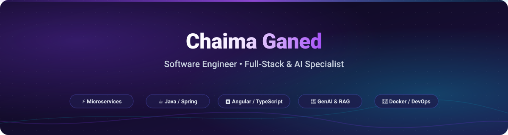

  

 

  
  
  

 

### 👩‍💻 À propos de moi / About Me

Ingénieure logicielle passionnée par la conception d'**architectures distribuées**, le développement **Full-Stack** et l'**Intelligence Artificielle générative**. J'aime concevoir des solutions robustes, résilientes et centrées sur l'utilisateur.

- 🔭 **Projets récents** : Systèmes RAG (Retrieval-Augmented Generation) pour la vérification scientifique & architectures microservices résilientes.
- ⚙️ **Spécialités** : Microservices, Patterns de résilience, RAG & LLMs, Algorithmes d'optimisation.
- 🎯 **Objectif** : Contribuer à des projets technologiques innovants et à fort impact.

---

### 🛠️ Compétences & Technologies / Tech Stack

#### ⚙️ Backend & Architecture

#### 🎨 Frontend

#### 🤖 Intelligence Artificielle & Data

#### 🚢 DevOps, Outils & Bases de données

---

### 🚀 Projets Phares / Featured Projects

| Projet | Description | Technologies |
| :--- | :--- | :--- |
| 🔍 **[claim-verifier](https://github.com/ChaimaGaned/claim-verifier)** | Vérification automatisée d'affirmations scientifiques via RAG avec arXiv API, FAISS et Groq LLM. | `Python` `FAISS` `Groq LLM` `RAG` |
| 🛡️ **[designPatterns-resilience](https://github.com/ChaimaGaned/designPatterns-resilience)** | Architecture e-commerce en microservices intégrant des patterns de résilience et load balancing. | `Java` `Spring Boot` `Docker` `Nginx` |
| 🧠 **[CortexRHIA](https://github.com/ChaimaGaned/CortexRHIA)** | Plateforme applicative intelligente pour l'optimisation des processus RH. | `Java` `Spring` `JavaScript` `Docker` |
| 🎓 **[SoutenancePlanification](https://github.com/ChaimaGaned/SoutenancePlanification)** | Application d'organisation des stages et d'attribution automatisée des soutenances par algorithme. | `Laravel` `Angular` `TypeScript` `PHP` |
| 🎟️ **[Event_Reservation](https://github.com/ChaimaGaned/Event_Reservation)** | Système complet de gestion d'événements et de réservation de billets en ligne. | `Symfony` `PHP` `Twig` `SQL` |
| 💼 **[TunisieFreelance](https://github.com/ChaimaGaned/TunisieFreelance-)** | Plateforme web collaborative pour freelances et donneurs d'ordres. | `Angular` `TypeScript` `HTML/CSS` |

---

### 📈 Statistiques GitHub

  
  

 

  

